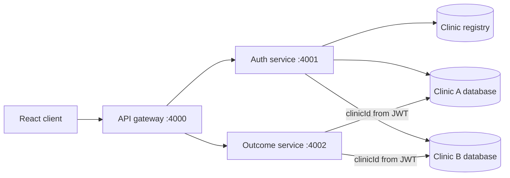

# Clinic outcome microservices

A MERN application for recording treatment outcomes while keeping each clinic's operational data in a separate MongoDB database. A small registry resolves a username to its clinic; authenticated outcome requests are then routed to that clinic's database.

This repository is a focused multi-tenant architecture demonstration. It includes an API gateway, authentication service, outcome service, React frontend and synthetic seed data.

## Tenant isolation



The registry stores clinic routing metadata and a username-to-clinic lookup. Password hashes and outcomes remain in the selected clinic database. After login, the JWT carries the clinic identifier used by the outcome service to select a connection.

This database-per-clinic model makes the isolation boundary easy to explain and inspect. A production design would also need connection lifecycle limits, tenant provisioning, key rotation, audit logging and stronger operational controls.

## Services

| Component | Port | Responsibility |
|---|---:|---|
| API gateway | 4000 | Routes client traffic to backend services |
| Auth service | 4001 | Resolves clinics, verifies users and issues JWTs |
| Outcome service | 4002 | Reads and writes outcomes in the selected clinic database |
| React frontend | 5173 | Login, dashboard, outcome entry and outcome history |
| MongoDB | 27017 | Registry plus one database per clinic |

## Local setup

Prerequisites: Node.js, npm and a local MongoDB instance.

Install all workspaces from the repository root:

```bash
npm run install:all
```

Create `.env` files in the three backend folders.

`api-gateway/.env`:

```dotenv
PORT=4000
AUTH_SERVICE_URL=http://localhost:4001
OUTCOME_SERVICE_URL=http://localhost:4002
```

`auth-service/.env`:

```dotenv
PORT=4001
MONGODB_REGISTRY_URI=mongodb://localhost:27017/patient_tracker_registry
MONGODB_BASE_URI=mongodb://localhost:27017
JWT_SECRET=replace-with-a-local-development-secret
JWT_EXPIRES_IN=24h
```

`outcome-service/.env`:

```dotenv
PORT=4002
MONGODB_REGISTRY_URI=mongodb://localhost:27017/patient_tracker_registry
MONGODB_BASE_URI=mongodb://localhost:27017
JWT_SECRET=replace-with-the-same-local-development-secret
```

The authentication and outcome services must use the same local signing secret. Do not commit real credentials.

Seed the synthetic clinics and outcomes:

```bash
npm run seed
```

Start each process in its own terminal:

```bash
npm run start:gateway
npm run start:auth
npm run start:outcome
cd frontend && npm run dev
```

Open `http://localhost:5173`.

## Request flow

### Login

1. The auth service finds the username in the registry.
2. The matching clinic database is opened.
3. The password is verified against that clinic's user record.
4. A JWT is issued with the clinic identifier and role.

### Outcomes

1. The outcome service verifies the JWT.
2. Middleware reads the clinic identifier from the verified token.
3. The connection manager selects that clinic's database.
4. Queries operate only on the selected database's outcome collection.

## Synthetic demo accounts

The seed script creates two clinics and example users for local demonstration. The credentials in the seed data are intentionally non-production values.

| Clinic | Username | Role |
|---|---|---|
| Sunrise Medical Center | `dr.smith` | Doctor |
| Sunrise Medical Center | `nurse.jones` | Nurse |
| Bayview Family Clinic | `dr.chen` | Doctor |
| Bayview Family Clinic | `admin.lee` | Admin |

Review `seed.js` for the current local demo password and generated records.

## Repository map

```text
api-gateway/       Request routing
auth-service/      Clinic lookup, authentication and token issuance
outcome-service/   Tenant-scoped outcome operations
frontend/          React user interface
seed.js            Coordinated synthetic data setup
```

## Current boundaries

- The repository contains no assertion-based automated test suite.
- Startup currently requires multiple terminals and a separately running MongoDB instance.
- The root frontend convenience scripts reference `npm start`, while the frontend package exposes `npm run dev`; use the documented command above.
- Database-per-clinic isolation is implemented in application logic and should be validated with runtime and adversarial tests.

Docker Compose would materially simplify coordinated startup for this project, but it is intentionally left as a future implementation rather than documented as an existing feature.
